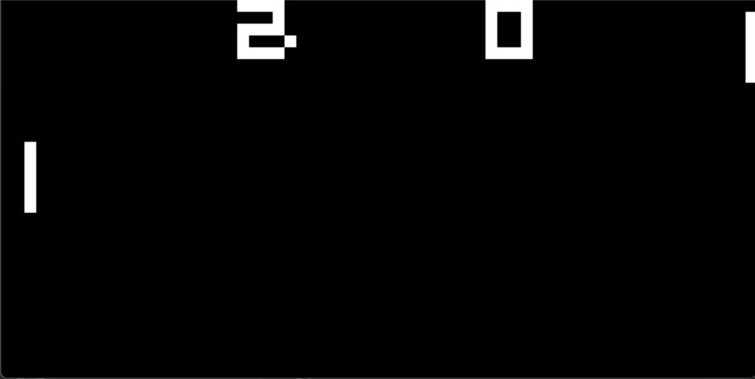

# CHIP-8 Emulator

A CHIP-8 emulator written in C++ using SDL2 for graphics and keyboard input.

This project helped me learn how instructions are fetched, decoded, and executed, and how memory, registers, graphics, and input work together.




## Features

- CHIP-8 opcode implementation using function pointer dispatch tables
- 4 KB of memory and 16 general-purpose registers
- 64 × 32 pixel display with adjustable window scale
- Keyboard input mapped to the 16-key CHIP-8 keypad
- Delay and sound timer countdowns at 60 Hz
- ROM loading from the command line

Audio output is not implemented yet.

## Requirements

- C++17-compatible compiler
- CMake 3.16 or newer
- SDL2 development libraries

The current CMake configuration targets Windows with MinGW. Update
`SDL2_ROOT` in `CMakeLists.txt` to point to your SDL2 installation.

## Build

Configure the project, providing the path to your SDL2 installation:

```bash
cmake -S . -B build -DCMAKE_PREFIX_PATH="C:/path/to/SDL2/x86_64-w64-mingw32"
```

Replace the example path with your actual SDL2 installation directory.

Then compile:

```bash
cmake --build build
```

CMake remembers the SDL2 location, so after editing the source code,
you can rebuild using just the second command.

## Run

From the project directory on Windows:

```powershell
.\build\chip8.exe <scale> <delay> <ROM>
```

For example:

```powershell
.\build\chip8.exe 10 2 pong.ch8
```

- **Scale:** window size multiplier. A scale of 10 produces a 640 × 320 window.
- **Delay:** milliseconds between CPU instructions. Smaller values run faster.
- **ROM:** path to the CHIP-8 ROM file.

## Controls

The CHIP-8 keypad maps to the following keyboard keys:

| CHIP-8 keypad | Keyboard |
|---|---|
| 1 2 3 C | 1 2 3 4 |
| 4 5 6 D | Q W E R |
| 7 8 9 E | A S D F |
| A 0 B F | Z X C V |

For the included Pong ROM, use **1** and **Q** to move your paddle.
Press **Escape** to quit.

## Code Structure

- `Chip8.h`: emulator state and method declarations
- `main.cpp`: opcode implementations, ROM loading, SDL platform class, and main loop
- `CMakeLists.txt`: build configuration

## Execution

The emulator loads a ROM into memory starting at address `0x200`.
Each CPU cycle fetches a two-byte instruction, decodes it, and calls
the matching opcode method through a function pointer table.

SDL2 handles keyboard events and displays the video buffer. Timers
are updated separately from CPU instruction execution.